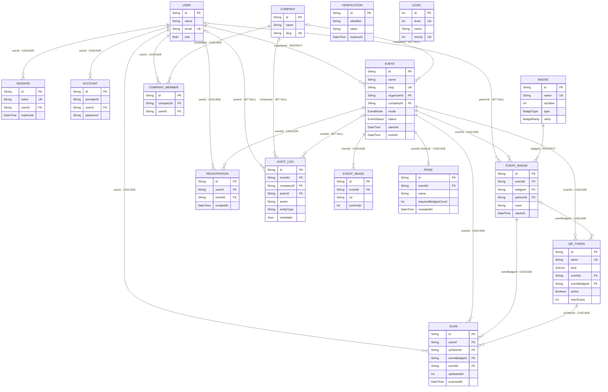

# Modelo de datos

`prisma/schema.prisma` es la única fuente de verdad del modelo. Este documento resume las
relaciones y las invariantes; [`docs/schema.sql`](./schema.sql) es el SQL generado desde ese
mismo schema. Las 8 migraciones en `prisma/migrations/` son el historial autorizado.

## Correspondencia de conceptos

| Concepto en español | Modelo | Rol |
| --- | --- | --- |
| usuarios | `User` | Persona autenticada (asistente, `ADMIN` o `SUPER_ADMIN`); origen de XP, niveles y auditoría |
| empresas | `Company` + `CompanyMember` | `Company` agrupa eventos; `CompanyMember` es la pertenencia N:M con `User` |
| eventos | `Event` | Charlas/stands, horario, sede, estado y organizador |
| badges | `Badge` + `EventBadge` | `Badge` es el catálogo global; `EventBadge` habilita ese badge en un evento (sala, inicio y socio opcional) |
| badges canjeados | `Scan` | Prueba de colección por asistente y badge; `xpAwarded` alimenta nivel y ranking |

Modelos de soporte: `QrToken` (QR físico), `Registration` (check-in), `Prize` (premio por
evento), `Level` (umbrales de XP), `EventImage` (galería), `AuditLog` (trazabilidad) y
`Session` / `Account` / `Verification` (Better Auth).

## Diagrama de relaciones



`VERIFICATION` y `LEVEL` no tienen foreign keys: la primera es un token de Better Auth y la
segunda es una tabla de umbrales consultada por XP. Las tablas de Better Auth se mapean a
nombres en minúscula (`user`, `session`, `account`, `verification`); el resto conserva el
nombre del modelo.

## Invariantes

| Invariante | Garantía |
| --- | --- |
| `EventBadge @@unique([eventId, badgeId])` | Un catálogo `Badge` solo puede estar habilitado una vez por evento |
| `Scan @@unique([userId, eventBadgeId])` | Un badge se cuenta una sola vez por asistente, aunque tenga varios QR |
| `Scan @@unique([userId, qrTokenId])` | Un mismo QR físico no otorga XP dos veces al mismo asistente |
| `Registration @@unique([userId, eventId])` | Un check-in por asistente y evento |
| `Prize.eventId @unique` | Relación 1:1 entre `Event` y su premio |
| `Event.organizerId` sin `onDelete` | `RESTRICT`: no se puede borrar al organizador mientras tenga eventos |
| `EventBadge.badgeId` sin `onDelete` | `RESTRICT`: no se puede borrar un badge de catálogo en uso |

El resto de las relaciones de dominio usan `CASCADE` (los hijos siguen al padre) o `SET NULL`
cuando el padre es opcional (`Event.companyId`, `EventBadge.partnerId` y los snapshots de
`AuditLog`). Estas reglas viven en la base de datos: los checks de aplicación compiten entre
sí y no bastan para evitar duplicados.

## Regenerar el SQL

```bash
pnpm exec prisma migrate diff --from-empty --to-schema=prisma/schema.prisma --script --output=docs/schema.sql
```

El comando se ejecuta desde la raíz del repo y carga la configuración desde `prisma7.config.ts`.
Si el schema cambia, volver a generar el archivo en vez de editarlo a mano.
